# Distributed Booking Platform

### Building a Reliable, Secure and Scalable Backend System

A hands-on distributed-systems project focused on the engineering challenges behind high-traffic applications: request routing, database concurrency, caching, asynchronous processing, network security, fault tolerance, observability, and safe deployments.

The goal is to evolve a containerized booking application into a system where multiple services work together reliably under concurrent traffic, infrastructure failures, and application updates.

**Project status:** Active development. Features are introduced incrementally, tested under load, and documented as they become available.

## Architecture Overview

The target architecture separates traffic management, application logic, data storage, background processing, and observability into distinct components.

```mermaid
flowchart TB
    Client["Client / API Consumer"]
    Edge["Nginx Reverse Proxy<br/>TLS, Routing, Rate Limiting"]
    App1["Booking API - Stable"]
    App2["Booking API - Canary"]
    Redis[("Redis<br/>Caching")]
    DB[("PostgreSQL<br/>Transactional Storage")]
    Queue["RabbitMQ"]
    Worker["Celery Workers"]
    Obs["Prometheus + Grafana<br/>Monitoring"]
    Test["Locust<br/>Load Testing"]

    Client --> Edge
    Edge --> App1
    Edge -. "Canary traffic" .-> App2
    App1 --> DB
    App2 --> DB
    App1 <--> Redis
    App2 <--> Redis
    App1 --> Queue
    App2 --> Queue
    Queue --> Worker
    App1 -. "Metrics and telemetry" .-> Obs
    App2 -. "Metrics and telemetry" .-> Obs
    Worker -. "Operational metrics" .-> Obs
    Test --> Edge
```



*This diagram represents the target design. Components and connections are enabled as their implementation is completed.*

## Engineering Objectives

### 1. Networking and Traffic Management

Understand how requests travel from a client to an application and how network infrastructure affects performance and reliability.

Planned areas of implementation:

- DNS resolution and the role of domain names.
- TCP connections, HTTP/1.1, HTTP/2, and connection reuse.
- TLS certificates, HTTPS termination, and secure communication.
- Nginx as a reverse proxy and Layer 7 traffic router.
- Forwarded headers, request identifiers, and client IP handling.
- Rate limiting, request timeouts, and upstream failure handling.
- Service-to-service communication inside Docker networks.
- Load balancing across multiple application instances.

### 2. Booking Consistency and Database Concurrency

A booking system must protect inventory when multiple users attempt to reserve the same resource simultaneously.

The implementation aims to explore:

- PostgreSQL transactions and ACID guarantees.
- Row-level locking with `SELECT ... FOR UPDATE`.
- Database constraints as a final safeguard against invalid data.
- Transaction isolation and deadlock handling.
- Atomic reservation creation and inventory updates.
- Idempotency for safely retrying requests.
- Concurrent load tests to detect race conditions and overbooking.

**Correctness target:** When 100 concurrent requests compete for one available unit, at most one should successfully reserve it. The test must verify the persisted database state, not just HTTP response codes.

### 3. Caching and Performance

Redis is used to explore ways to reduce repeated database reads and improve response times.

Areas of focus:

- Cache-aside patterns for frequently requested data.
- TTL-based expiration and cache invalidation.
- Cache consistency when reservations change inventory.
- Cache stampedes and concurrent cache misses.
- Database connection limits and query performance.
- Measuring latency and throughput before and after optimization.

Performance improvements will be measured under a defined workload rather than assumed from the use of a cache.

### 4. Asynchronous Processing

RabbitMQ and Celery provide a foundation for studying background work and message-driven processing.

Topics include:

- Separating API request handling from long-running tasks.
- Message acknowledgements, retries, and dead-letter queues.
- Handling duplicate message delivery.
- Idempotent background jobs.
- Worker scaling and queue backlogs.
- Failure recovery and task observability.

### 5. Security

Security is treated as a design requirement across the request path, application, and infrastructure.

Planned areas include:

- HTTPS and TLS configuration.
- Input validation and safe error responses.
- Authentication and authorization.
- Secret management and environment-based configuration.
- Least-privilege database access.
- Internal-only access to databases, caches, and administration interfaces.
- Rate limiting and request-size limits.
- Dependency scanning and container image hardening.
- Protection against common API security vulnerabilities.

The objective is to understand which layer provides each protection and how the controls work together.

### 6. High Availability and Failure Handling

The project will explore how a distributed application behaves when individual components become unhealthy.

Planned areas include:

- Health checks and dependency readiness.
- Multiple application instances behind a gateway.
- Connection and request timeouts.
- Bounded retries and exponential backoff.
- Graceful degradation when dependencies fail.
- Process recovery and restart policies.
- Failure injection and recovery testing.
- Identifying single points of failure and understanding their trade-offs.

Running multiple containers locally is a learning environment, not a guarantee of production high availability. Production availability also depends on infrastructure redundancy, deployment topology, data durability, and operational practices.

### 7. Canary Deployments and Safe Rollbacks

The deployment layer is intended to demonstrate how a new application version can be introduced without immediately sending all traffic to it.

The planned workflow is:

1. Run a stable application version.
2. Deploy a separate candidate version.
3. Route a controlled portion of traffic to the candidate.
4. Compare error rates and latency against defined thresholds.
5. Stop or roll back the rollout when the candidate violates those thresholds.
6. Verify that the stable version continues serving requests.

Nginx traffic splitting and an automated rollback controller are roadmap items until implemented and tested. A successful rollback must be verified through actual traffic behavior, not merely a configuration change.

### 8. Observability and Load Testing

Prometheus, Grafana, and Locust provide tools for understanding system behavior under load.

The project will measure:

- Request rate and error rate.
- p50, p95, and p99 response latency.
- Database query latency and connection utilization.
- Cache hit rate.
- Queue depth and task processing time.
- Resource utilization and service health.
- Booking success, conflict, and failure rates.

Load tests will be used to establish a baseline, identify bottlenecks, and compare the effects of architectural changes.

## Technology Stack

| Technology | Role |
|---|---|
| Python 3.12 | Backend development |
| FastAPI | REST API and request validation |
| PostgreSQL 16 | Persistent relational data |
| Redis 7 | Caching and coordination experiments |
| RabbitMQ | Message broker |
| Celery | Background task processing |
| Nginx | Planned edge gateway and traffic management |
| Docker Compose | Local multi-service environment |
| Prometheus | Metrics collection |
| Grafana | Monitoring dashboards |
| OpenTelemetry Collector | Telemetry collection and export |
| Locust | Load and concurrency testing |
| Git and GitHub | Version control and collaborative development |

## Getting Started

### Prerequisites

- [Docker Desktop](https://www.docker.com/products/docker-desktop/)
- Docker Compose v2
- [Git](https://git-scm.com/)

### 1. Clone the repository

```bash
git clone https://github.com/Deepak126678/distributed-booking-platform.git
cd distributed-booking-platform
```

### 2. Start the services

Run the command from the repository root:

```bash
docker compose -p booking-dev -f docker-compose.yaml up -d --build
```

### 3. Verify the containers

```bash
docker compose -p booking-dev -f docker-compose.yaml ps
```

Wait for the application and its dependencies to become ready.

### 4. Test the API

- API root: http://localhost:8080/
- Interactive API documentation: http://localhost:8080/docs

On Windows PowerShell:

```powershell
Invoke-RestMethod http://localhost:8080/
```

### 5. Inspect logs

```bash
docker compose -p booking-dev -f docker-compose.yaml logs --tail 100 app
```

To inspect a different service, replace `app` with its service name.

## Local Development Tools

The current Compose configuration exposes these development interfaces:

| Service | Local URL |
|---|---|
| Booking API | http://localhost:8080 |
| FastAPI documentation | http://localhost:8080/docs |
| Prometheus | http://localhost:9091 |
| Grafana | http://localhost:3001 |
| MailHog | http://localhost:8026 |
| pgAdmin | http://localhost:5051 |
| Celery Flower | http://localhost:5556 |
| Locust | http://localhost:8090 |

These interfaces are for local development. Their presence does not mean every dashboard, metric, or load-testing scenario is already configured correctly. Review the Compose configuration for service credentials and access settings.

## Project Structure

```text
distributed-booking-platform/
├── docker-compose.yaml
├── database/
│   └── init.sql
├── infra/
│   ├── nginx/
│   ├── observability/
│   │   ├── grafana/
│   │   ├── prometheus/
│   │   └── otel-collector-config.yaml
│   └── postgres/
│       └── init/
├── tests/
│   └── load/
├── docs/
└── upstream/
    └── booking-app/
        ├── app/
        ├── Dockerfile
        ├── Dockerfile.worker
        ├── Dockerfile.locust
        └── requirements.txt
```

## Development Roadmap

| Phase | Focus | Completion criteria |
|---|---|---|
| 1. Foundation | Containers, API, database, and local environment | Services start reliably and API requests succeed |
| 2. Network gateway | Nginx, TLS, reverse proxy, and upstream connections | HTTPS and proxy behavior are verified |
| 3. Traffic protection | Rate limiting, timeouts, and request tracing | Limits and request identifiers are tested |
| 4. Data correctness | Transactions, row locking, and idempotency | Concurrent tests show no overbooking or duplicate effects |
| 5. Performance | Redis caching and query optimization | Benchmarks demonstrate measurable improvements |
| 6. Background processing | RabbitMQ, Celery, and retry handling | Failed and duplicate task scenarios are tested |
| 7. Progressive delivery | Stable and candidate versions, canary routing, and rollback | Injected failures trigger a verified rollback |
| 8. Reliability and security | Failure testing, access controls, and hardening | Documented tests validate the intended protections |

## Engineering Principles

- Prefer correctness over premature optimization.
- Enforce critical data invariants in the database.
- Make retry behavior explicit and safe.
- Keep internal services isolated from unnecessary public access.
- Measure latency, throughput, and resource usage instead of guessing.
- Test failure scenarios, not only successful requests.
- Document architectural decisions and their trade-offs.
- Treat security, observability, and maintainability as part of system design.

## Learning Outcomes

This project is intended to build practical understanding of backend and distributed-systems engineering, including:

- Request flow from the client through the network and gateway to the database.
- Concurrency control and transactional consistency.
- Caching, queues, and asynchronous execution.
- Network boundaries and service discovery.
- Secure service configuration and traffic management.
- Load testing, performance analysis, and failure recovery.
- Progressive deployments and operational monitoring.

The focus is not simply to assemble tools, but to understand why each component exists, what failure it addresses, and how to demonstrate that it works.

## License

This project is intended to be distributed under the MIT License. See the `LICENSE` file for the applicable terms.
