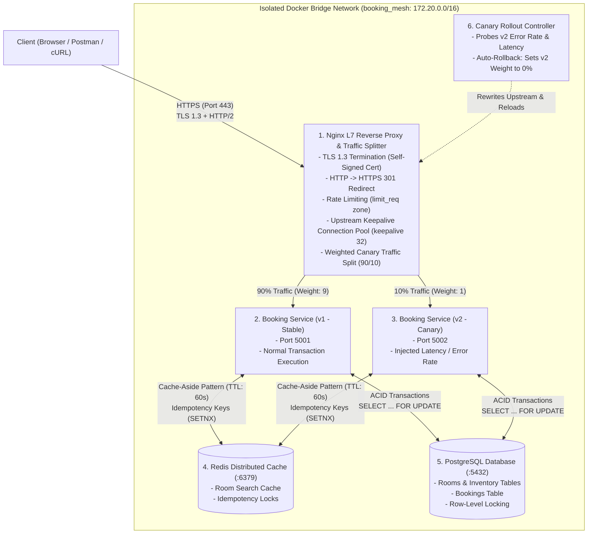

# Distributed Booking Platform: High-Availability Microservices, Nginx L7 Gateway, PostgreSQL Concurrency Locking, Redis Caching & Canary Rollbacks

[](https://opensource.org/licenses/MIT)
[](https://www.python.org/)
[](https://fastapi.tiangolo.com/)
[](https://www.postgresql.org/)
[](https://redis.io/)
[](https://www.docker.com/)

A production-grade distributed reservation system engineered for **high concurrency**, **zero-overbooking guarantees**, and **resilient edge traffic management**.

The project pairs an open-source, transactional **FastAPI Booking Microservice** backed by **PostgreSQL** with an **Nginx Layer 7 Edge Reverse Proxy**, **Redis Distributed Caching & Idempotency**, and an **Autonomous Canary Rollback Controller**.

---

## 🏛️ System Architecture



---

## 💻 System Resource Allocation & Hardware Footprint

Designed to run smoothly on any developer laptop with **< 200 MB RAM total footprint**:

| Component | RAM Allocation | Architectural Characteristics |
|---|---|---|
| **Nginx (Edge Proxy & LB)** | **~10 MB RAM** | C-based event-driven I/O (`epoll`); TLS termination and connection pooling. |
| **PostgreSQL 16** | **~35 MB RAM** | Relational ACID storage with row-level lock management. |
| **Redis 7** | **~15 MB RAM** | In-memory key-value engine for search caching and idempotency locks. |
| **Booking API (v1 - Stable)** | **~50 MB RAM** | Python 3.12 / FastAPI instance handling stable production traffic. |
| **Booking API (v2 - Canary)** | **~50 MB RAM** | Python 3.12 / FastAPI canary instance running performance tests. |
| **Rollout Controller** | **~10 MB RAM** | Lightweight health-monitoring reconciliation daemon. |

---

## ⚙️ Core Engineering Modules

### 1. Upstream Workload (Open-Source Base)
* Powered by a modular FastAPI reservation service with pre-configured relational models for **Units** (rooms/inventory), **Guests** (users), and **Reservations**.
* Base upstream attribution: [`fastapi-booking`](https://github.com/guduchango/fastapi-booking).

### 2. Concurrency Control & Anti-Overbooking
* Eliminates race conditions when multiple concurrent users attempt to reserve the last inventory item.
* Enforces PostgreSQL **Row-Level Locking (`SELECT ... FOR UPDATE`)** inside database transactions. When 100 parallel requests compete for 1 room, exactly 1 succeeds (HTTP 201) and 99 fail safely (HTTP 409 Conflict).

### 3. Network Idempotency Engine
* Enforces unique `Idempotency-Key` headers on booking requests.
* Uses Redis `SET idemp:<key> "IN_PROGRESS" NX EX 60`. If client retries after a network drop, the backend immediately returns the cached booking confirmation rather than double-booking or double-charging.

### 4. High-Speed Cache-Aside Engine (Redis)
* Caches room availability queries (`GET /api/v1/units/`) in Redis with a 60-second TTL.
* Serves repeat queries in **< 1ms**, shielding PostgreSQL from read saturation during traffic surges.

### 5. Nginx L7 Edge Reverse Proxy & Connection Pooling
* **TLS 1.3 & HTTP/2:** Terminates TLS 1.3 on port 443 with modern cryptographic ciphers and HTTP/2 binary framing. Enforces HTTP $\to$ HTTPS 301 redirects.
* **Keepalive Connection Pooling:** Maintains persistent TCP sockets to upstream backends (`keepalive 32`), eliminating the overhead of 3-way handshakes on every request.
* **Edge Rate Limiting:** Enforces a leaky-bucket rate limiter (`limit_req_zone`, 10 req/s) to absorb DDoS bursts with clean `429 Too Many Requests`.

### 6. Weighted Canary Routing & Automated Rollback
* Routes 90% of traffic to `booking_v1` and 10% to `booking_v2`.
* Background reconciliation controller continuously monitors canary error rates and p99 latency. If an anomaly is detected, it autonomously rewrites the Nginx upstream weight to 0% and executes `nginx -s reload` with zero downtime.

---

## 🚀 Quick Start (Local Setup)

### Prerequisites
* [Docker Desktop](https://www.docker.com/products/docker-desktop/) (Docker 24+ & Docker Compose v2+)
* `curl` or Postman

### 1. Clone the Repository
```bash
git clone https://github.com/Deepak126678/distributed-booking-platform.git
cd distributed-booking-platform
```

### 2. Start the Multi-Container Mesh
```bash
docker compose up -d --build
```

### 3. Verify Health & Seed Data
```bash
# Query Stable Instance v1 (Port 5001)
curl http://localhost:5001/api/v1/units/

# Query Canary Instance v2 (Port 5002)
curl http://localhost:5002/api/v1/units/
```

Both endpoints will return the 5 seeded hotel rooms from PostgreSQL:
* `Deluxe Suite 101`
* `Executive Suite 102`
* `Ocean View 103`
* `Presidential Suite 104`
* `Standard Room 105`

---

## 📡 API Specification

| Method | Endpoint | Description |
|---|---|---|
| `GET` | `/api/v1/units/` | List all available rooms/units (accelerated by Redis) |
| `POST` | `/api/v1/units/` | Create a new room/inventory item |
| `POST` | `/api/v1/reservations/` | Book a room with row-level locking & idempotency |
| `GET` | `/api/v1/guests/` | List registered guests |
| `GET` | `/health` | Instance health check |

---

## 📄 License
This project is licensed under the [MIT License](LICENSE).
